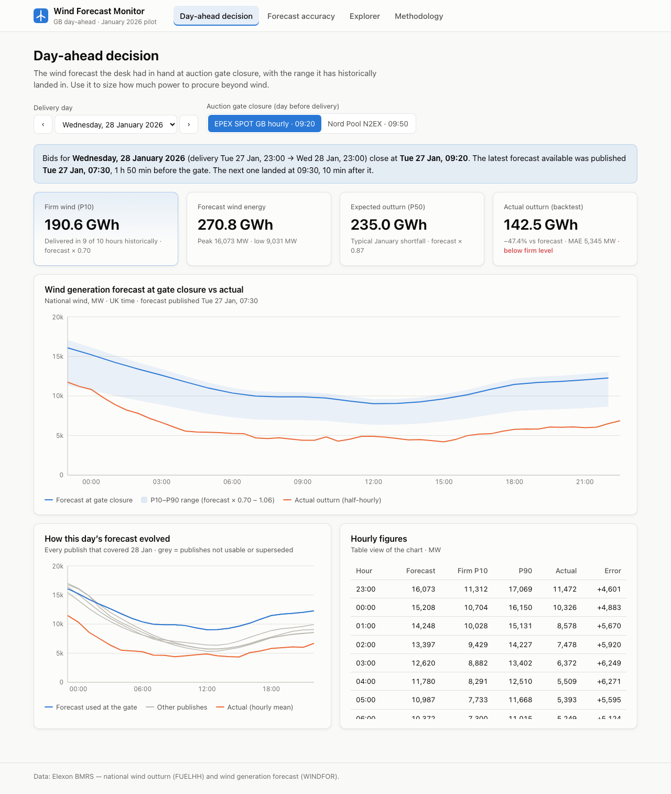

# UK Wind Forecast Monitor

Decision support for a UK utility's day-ahead power trading desk. For every delivery day
it shows:
- the national wind forecast that was **actually available at auction gate closure**
- the range that forecast has historically landed in
- how accurate it has been across **every purchase decision made in January 2026**

**Live app:** https://wind-forecast-monitor-195551097917.europe-west2.run.app/ (Google Cloud Run, London region)



## What it does

| Page | Question it answers |
|---|---|
| **Day-ahead decision** | For delivery day D, which forecast did the desk have at the 09:20 (EPEX) or 09:50 (N2EX) gate on D-1? How much wind can it count on (P10 "firm wind")? How did it turn out? |
| **Forecast accuracy** | MAE, RMSE, bias and error quantiles over the pilot. Error by day, forecast level, lead time and hour of day. Does a later gate help? What would a simple bias correction gain? |
| **Explorer** | Actual vs the forecast made at least *H* hours ahead, over any date range (horizon slider 0–48 h). |
| **Methodology** | Data sources, decision timeline, metric definitions, caveats. |

Headline findings (details in [docs/ANALYSIS.md](docs/ANALYSIS.md)):
- **Accuracy at the EPEX gate:** MAE 2,035 MW (18% of mean wind).
- **Bias:** the forecast over-states wind by **+1,749 MW on average**. It was too high in
  85% of hours, and the overstatement grows with forecast level.
- **Bias correction:** a look-ahead-free correction based on the previous week cuts MAE
  by **24%**.
- **Later gate:** waiting for N2EX's later gate improves MAE by only 1.3%.

## Quick start

### Docker (production-like)

```bash
docker compose up --build
# open http://localhost:8000
```

This builds a single image. Node builds the React app, then a slim Python image runs
FastAPI, which serves both `/api` and the UI.

### Local development

Needs Python 3.12+ and Node 22+.

```bash
make install    # backend/.venv + frontend/node_modules
make dev-api    # FastAPI with reload on http://localhost:8000  (API docs at /docs)
make dev-ui     # Vite on http://localhost:5173, proxies /api to :8000
```

### Tests, lint, data refresh

```bash
make test       # pytest (47 tests, no network needed)
make lint       # ruff + eslint + prettier
make data       # re-download the January 2026 snapshot from Elexon
```

## Repository structure

```
.
├── backend/                     Python API (FastAPI + pandas)
│   ├── app/
│   │   ├── main.py              App factory: /api router, CORS for dev, serves the built SPA
│   │   ├── config.py            Settings from APP_* environment variables
│   │   ├── market.py            GB day-ahead rules: gate closures, 23:00→23:00 delivery day, pilot window
│   │   ├── elexon/client.py     Elexon BMRS client (FUELHH, WINDFOR): chunking, retries, de-duplication
│   │   ├── data/store.py        Loads the snapshot: dedupe, half-hour→hourly, drop negative horizons
│   │   ├── analytics/
│   │   │   ├── selection.py     Which forecast was in force at gate closure / at horizon H
│   │   │   └── metrics.py       MAE, RMSE, bias, quantiles, breakdowns, trailing bias adjustment
│   │   ├── services.py          Composes analytics into API responses, cached per gate
│   │   ├── schemas.py           Pydantic response models (the API contract)
│   │   └── api/routes.py        HTTP endpoints and error mapping
│   ├── scripts/fetch_data.py    Downloads the pilot dataset from Elexon
│   ├── data/                    Committed snapshot: fuelhh_wind.csv.gz, windfor.csv.gz, snapshot.json
│   ├── tests/                   pytest suite (unit, API contract, snapshot regression)
│   ├── requirements*.txt        Pinned runtime / dev dependencies
│   └── pyproject.toml           Ruff and pytest configuration
├── frontend/                    React 18 + TypeScript + Vite + Recharts
│   ├── src/
│   │   ├── pages/               DecisionPage, AccuracyPage, ExplorerPage, MethodologyPage
│   │   ├── components/          Cards/KPIs, gate selector, loading/error states, shared chart parts
│   │   ├── api/                 Typed API client and types mirroring backend/app/schemas.py
│   │   ├── lib/                 Formatting (UK time, MW/GWh), data-fetch and utility hooks
│   │   ├── AppContext.tsx       Pilot metadata + selected gate shared across pages
│   │   └── styles.css           Design tokens (light/dark) and layout
│   ├── vite.config.ts           Dev proxy /api → :8000
│   └── eslint.config.js, .prettierrc.json, tsconfig*.json
├── docs/
│   ├── ARCHITECTURE.md          Layers, data flow diagram, design decisions, testing
│   ├── ANALYSIS.md              January 2026 findings with figures
│   └── images/                  README screenshots
├── deploy/cloudrun.sh           Build with Cloud Build and deploy to Google Cloud Run
├── Dockerfile                   Multi-stage build (Node → Python), non-root, healthcheck
├── docker-compose.yml           Local production-like run on :8000
├── Makefile                     install / dev / test / lint / data / docker shortcuts
└── .github/workflows/ci.yml     CI: backend lint+tests, frontend lint+build, Docker smoke test
```

## API

All endpoints are `GET` and return JSON. Interactive documentation is at `/docs`.

| Endpoint | Description |
|---|---|
| `/api/health` | Liveness |
| `/api/meta` | Pilot delivery days, gate presets, snapshot and data-quality facts |
| `/api/decision?delivery_date=2026-01-16&gate=epex` | Forecast in force at the gate, P10–P90 band, actuals, all forecast vintages for the day. `gate` = `epex`, `n2ex` or `HH:MM` |
| `/api/accuracy?gate=epex&from=&to=` | Summary metrics and breakdowns over the pilot or a sub-range |
| `/api/horizon` | MAE and bias against minimum forecast lead time (0–48 h) |
| `/api/series?horizon_h=24&start=&end=` | Actual vs latest forecast published at least `horizon_h` hours ahead |

## Key assumptions

- **Data:** only Elexon national wind data is used: `FUELHH` (`fuelType=WIND`) for actuals
  and `WINDFOR` for forecasts.
- **Pilot window:** purchase decisions made 1–31 Jan 2026, which means delivery days
  2 Jan – 1 Feb 2026.
- **Delivery day:** 23:00 → 23:00 UK time, as in the GB day-ahead auctions.
- **Gate closures:** EPEX SPOT GB hourly at 09:20 and Nord Pool N2EX at 09:50, UK time on
  D-1. Any custom `HH:MM` also works.
- **Hourly comparison:** forecasts are hourly and actuals half-hourly, so they are compared
  hourly using the mean of the two half-hours.
- **Uncertainty bands** are percentiles of actual ÷ forecast over the pilot month. These
  are in-sample; a production version would use a trailing window.

## Deployment

The app is deployed to Google Cloud Run (region `europe-west2`, London) from the same
Dockerfile:

```bash
PROJECT_ID=<gcp-project> ./deploy/cloudrun.sh
```

## Use of AI tools

AI coding assistants were used during development: for scaffolding, boilerplate,
refactoring suggestions and drafting documentation. All design decisions, domain modelling
and analysis were reviewed and verified by the author. Values shown in the app were
cross-checked against the live Elexon API.
