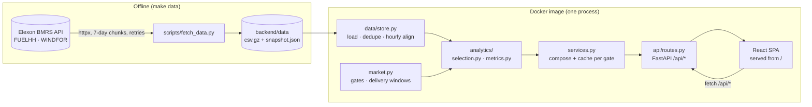

# Architecture

## Overview

The app is one container. FastAPI serves the JSON API under `/api` and the built React
app from `/`. Because both share an origin there is no CORS in production and nothing to
configure between them. Vite proxies `/api` to the backend in development.

## Backend layers

| Layer | File(s) | Responsibility | Depends on |
|---|---|---|---|
| Market rules | `app/market.py` | Gate-closure presets, the 23:00→23:00 UK delivery day, the pilot window. Every timing assumption lives here. | stdlib only |
| Ingestion | `app/elexon/client.py`, `scripts/fetch_data.py` | Typed client for the two `/stream` endpoints: chunking, retry with backoff on 5xx and network errors, de-duplication at chunk edges. | httpx |
| Data | `app/data/store.py` | Load the snapshot. Keep the latest revision per half-hour, build hourly means, drop negative-horizon forecast rows, produce a quality report. | pandas |
| Analytics | `app/analytics/selection.py`, `app/analytics/metrics.py` | Pure functions, DataFrames in and out: which forecast was in force, error metrics and breakdowns. | pandas, market |
| Service | `app/services.py` | Compose analytics into response models; `lru_cache` per gate, since the snapshot is immutable. | analytics, schemas |
| HTTP | `app/api/routes.py`, `app/schemas.py` | Parse and validate parameters, map domain errors to 404/422, publish typed response models (OpenAPI at `/docs`). | FastAPI |

The rule throughout is that **pure logic never touches HTTP and HTTP never touches pandas.**
That is what makes the analytics unit-testable with tiny hand-built frames.

### Key decisions

- **Snapshot instead of live calls at request time.** The pilot is a fixed historical
  month, and the data is small (about 20k forecast rows). Shipping it with the image makes
  the demo fast, deterministic and independent of Elexon's availability.
  `make data` refreshes it. A live deployment would swap `store.py` for a scheduled
  ingest into a database without touching the analytics.
- **pandas, not a database.** At this volume an in-memory frame answers every query in
  milliseconds (the cold `/api/accuracy` call takes about 40 ms).
- **Ratio-based uncertainty band.** Quantiles of actual/forecast scale with the forecast
  level. On the pilot data they hold about 95% coverage in the top forecast quartile,
  where an additive MW band only reaches about 76%. See [ANALYSIS.md](ANALYSIS.md).
- **Look-ahead discipline.** Selection uses only `publish_time ≤ gate closure`. The
  bias adjustment uses only delivery days settled by D-2. Both are covered by tests.

## Frontend

| Path | Purpose |
|---|---|
| `src/api/types.ts`, `src/api/client.ts` | Hand-written mirror of `schemas.py` and a typed `fetch` wrapper. |
| `src/lib/useApi.ts` | Fetch hook keyed by a string. It aborts stale requests and keeps the previous data while refetching, so charts dim instead of flashing. |
| `src/AppContext.tsx` | Pilot metadata and the selected gate, shared across pages. |
| `src/pages/*` | Decision, Accuracy, Explorer, Methodology. |
| `src/components/charts/*` | Shared chart chrome: axes, round-step ticks, tooltip, legend, bar shape. |
| `src/styles.css` | Design tokens for light and dark. Chart colours are fixed per meaning (blue = forecast, orange = actual, red/blue = over/under, violet = MAE). |

React 18, React Router 7, Recharts 2 and Vite 6. There is no state library: the only
cross-page state is the gate, kept in context. The delivery day lives in the URL
(`/?day=2026-01-12`), so views can be linked.

## Testing and quality

- `backend/tests` has 47 pytest tests:
  - market calendar, including clock-change days
  - client retry and de-duplication, using `httpx.MockTransport` (no network)
  - store cleaning, selection rules and metrics
  - API contract tests
  - regression checks against values verified on the live API
- Ruff (lint and format) for Python; ESLint, Prettier and `tsc --strict` for TypeScript.
- GitHub Actions has three jobs: backend, frontend, and a Docker build that runs the
  container and smoke-tests it.

## Deployment

`deploy/cloudrun.sh` runs `gcloud run deploy --source .`:
- Cloud Build builds the same Dockerfile.
- Cloud Run runs it in `europe-west2`, scaling to zero, with unauthenticated access.
- The container listens on `$PORT`.
